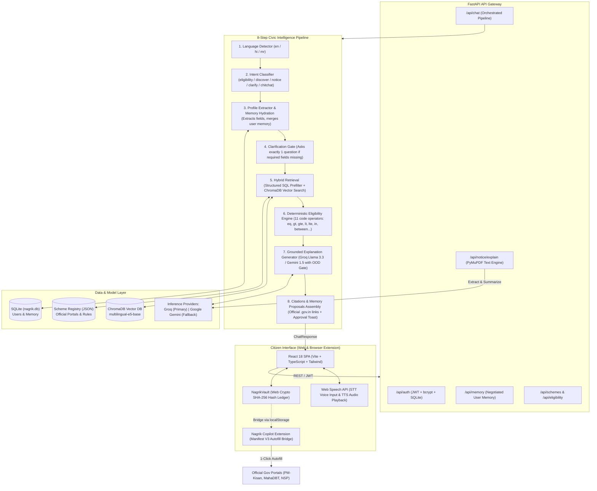

# NagrikAI — Multilingual Civic Intelligence Platform

> **IDEA//FORGE Online Hackathon 2026** | **Track 1: Civic Pulse — Digital Governance & Public Information**  
> **Problem Statement 1:** *Multilingual Policy, Rights & Scheme Explainer*  
> **Status:** ✅ 100% Complete & Verified (Phases 0–12) | **Test Suite:** 19/19 Passing | **Frontend:** 0 TypeScript Errors

[](https://fastapi.tiangolo.com)
[](https://react.dev)
[](https://tailwindcss.com)
[](https://www.trychroma.com)
[](https://groq.com)
[](https://developer.chrome.com/docs/extensions)
[](#-privacy-compliance--safety)

---

## 📌 Problem Statement & Context

Over **800 central and state welfare schemes** exist in India to support farmers, students, women, and economically weaker sections. Yet, **millions of eligible citizens fail to receive their rightful benefits** due to:

1. **Complex Bureaucratic Jargon:** Official Government Resolutions (GRs) and circulars are written in dense, legalistic English or regional languages that an average citizen cannot decode.
2. **Linguistic Exclusion:** Policy notifications are rarely accessible in conversational regional languages, shutting out rural and non-English-speaking communities.
3. **Opaque & Fragmented Eligibility Rules:** Citizens must navigate dozens of conflicting portals, unaware of the specific income, land, or caste requirements until after rejection.
4. **LLM Hallucinations in Civic Tech:** Off-the-shelf generative AI bots invent eligibility criteria, fabricate deadlines, and misquote laws, causing citizens real financial distress.
5. **Cumbersome Application Friction:** Repeatedly typing the same personal and family details into clunky government forms leads to errors, delays, and reliance on predatory middlemen.

---

## 💡 The Solution: NagrikAI

**NagrikAI** is an end-to-end civic intelligence ecosystem engineered to make welfare policies completely transparent, instantly understandable, and easily actionable in **English**, **Hindi (हिंदी)**, and **Marathi (मराठी)**.

### Core Pillars
- **Zero Hallucination Eligibility Engine:** Eligibility decisions are executed deterministically in code via mathematical and boolean rule operators. The LLM is **strictly forbidden** from deciding eligibility; it only provides grounded, conversational translations of code-verified facts.
- **Multimodal Voice & Chat Interface:** Real-time conversational AI equipped with Web Speech Speech-to-Text (STT) and SpeechSynthesis (TTS) tailored for Indian accents and regional languages.
- **Official Government Notice Explainer:** Upload any government circular or gazette PDF/image; PyMuPDF extracts text, filters boilerplate noise, and yields a school-student-level plain-language breakdown with page citations.
- **NagrikVault (Client-Side Cryptographic Locker):** Local browser storage with SHA-256 verifiable hash ledgers and AES-256 encryption demonstration. Automatically extracts key criteria (land size, annual income, social category) into the citizen profile without server exposure.
- **Nagrik Copilot Browser Extension (Manifest V3):** A Chrome extension that bridges verified NagrikVault data to auto-fill official government scheme portals in one click.
- **Negotiated Memory System:** Citizens maintain total sovereignty over their stored data. The AI proposes memory entries via toast notifications, which the citizen can explicitly approve, edit, or reject before persistence.
- **Explainability Layer ("Why this answer?"):** Complete glass-box audit trail under every AI response displaying classified intent, retrieved chunks with relevance scores, memory fields used, and exact eligibility rules evaluated.

---

## 🏛️ System Architecture

NagrikAI separates non-deterministic language understanding from deterministic civic decision logic:



---

## ⚡ The 8-Step Civic Pipeline Explained

1. **Language Detection (`pipeline/orchestrator.py`):** Identifies English, Hindi, Marathi, or Hinglish with per-message and per-session persistence.
2. **Intent Classification (`pipeline/intent.py`):** Categorizes queries into `eligibility`, `discover`, `ask_question`, `explain_notice`, `compare`, or `chitchat`.
3. **Profile Extraction & Memory Hydration (`pipeline/profile.py` & `memory.py`):** Extracts attributes (occupation, land holding, annual income, caste, domicile) and merges previously approved user memories from the SQLite database.
4. **Single-Turn Clarification Gate:** If critical fields are missing to evaluate a requested scheme, the AI halts search and asks **exactly one focused clarifying question** (e.g. *"What is your annual family income?"*).
5. **Hybrid Retrieval (`pipeline/retrieval.py`):** Performs structured pre-filtering by state, occupation, and caste, followed by dense semantic vector search via **ChromaDB** using `intfloat/multilingual-e5-base`.
6. **Deterministic Rule Engine (`pipeline/eligibility.py`):** Evaluates eligibility across 11 mathematical operators (`eq`, `neq`, `gt`, `gte`, `lt`, `lte`, `in`, `not_in`, `contains`, `between`, `regex`). Checks hard exclusions. The overall status is strictly computed as `eligible`, `ineligible`, or `need_more_info`.
7. **Grounded Explanation Generator (`pipeline/explain.py`):** Feeds verified facts, criterion outcomes, and retrieved chunks to Groq/Gemini with temperature locked $\le 0.2$. If information is absent from official source text, an **Out-Of-Distribution (OOD) Gate** forces the model to state that it is not specified and links the official government portal.
8. **Citations & Memory Proposal Assembly:** Packages verbatim page numbers, official `.gov.in` source links, required application documents, and generates proposals for newly extracted citizen facts.

---

## ✨ Key Features & Capabilities

### 1. Scheme Chat with Multilingual Voice
- Full bidirectional conversation in **English**, **Hindi (हिंदी)**, and **Marathi (मराठी)**.
- Hands-free voice recognition using the browser's native **Web Speech STT** and audio read-aloud via **SpeechSynthesis TTS**.
- Interactive sector discovery cards for **Agriculture**, **Education**, **Women & Families**, and **Health**.

### 2. Deterministic Eligibility Engine
- Zero black-box hallucinations.
- Detailed checklist for every scheme condition:
  - ✅ **Met:** Criterion passed with evaluated citizen value.
  - ❌ **Not Met:** Criterion failed with specific disqualification reason.
  - ❓ **Missing:** Clarification needed to make an accurate determination.

### 3. Government Notice & Circular Explainer
- Upload official Gazette notifications, Government Resolutions (GRs), and circulars in **PDF**, **JPEG**, or **PNG** format (up to 10 MB, 30 pages).
- Text extraction powered by **PyMuPDF (`fitz`)** with automated running-header noise filtering.
- Yields:
  - **Executive Summary:** Plain-language summary (3–5 sentences, school-student reading level).
  - **Key Policy Decisions:** Numbered operational directives.
  - **Target Beneficiary Groups:** Demographics impacted (students, smallholders, women).
  - **Important Deadlines:** Application windows, verification cutoffs, and disbursement dates.
  - **Verifiable Citations:** Collapsible list showing exact page text snippets.

### 4. NagrikVault — Client-Side Cryptographic Locker
- Secure local document depository for **Income Certificates**, **7/12 Land Records**, **Caste Certificates**, and **Academic Marksheets**.
- Real cryptographic integrity validation using **Web Crypto API SHA-256** hashing.
- Displays tamper-proof SHA-256 digital fingerprint ledger.
- One-click profile auto-extraction: updates citizen land holdings, annual income, and caste directly from uploaded records.

### 5. Nagrik Copilot Browser Extension (Manifest V3)
- Chromium extension (Chrome / Edge / Brave) connecting NagrikVault to real-world government web portals.
- Listens to verified vault synchronization via cross-origin events.
- **1-Click Auto-Fill:** Detects form inputs (Name, Category, Land Size, Income, State, District, IFSC/Account) and populates them instantly.
- Human-in-the-loop confirmation modal prevents premature submission.
- Includes a built-in interactive demo portal for live judge evaluations.

### 6. Negotiated Memory System
- Solves AI amnesia while preserving citizen consent and privacy.
- When new citizen attributes are detected during chat, NagrikAI displays a non-intrusive proposal toast:
  > *"NagrikAI wants to remember: **occupation = farmer** [✓ Save] [✗ Dismiss] [Edit]"*
- Stored memories persist across sessions in `nagrik.db` and can be inspected, edited, or purged at any time from the **Memory Panel (🧠)**.

### 7. Glass-Box Explainability Layer ("Why this answer?")
- Every AI response features a collapsible audit drawer containing:
  - **Classified Intent:** The intent detected by the natural language parser.
  - **Retrieved Chunks:** Source text excerpts, document titles, pages, and cosine similarity scores.
  - **Memory Fields Used:** Which fields were retrieved from long-term memory vs. conversational context.
  - **Eligibility Operators Evaluated:** The mathematical operations executed by code.

---

## 💻 Tech Stack

| Layer | Technologies Used |
|---|---|
| **Frontend SPA** | React 18, TypeScript, Vite 8, Tailwind CSS, Lucide React Icons |
| **Voice & Speech** | Web Speech API (`SpeechRecognition`, `SpeechGrammarList`, `speechSynthesis`) |
| **Cryptography** | Web Crypto API (`crypto.subtle.digest` SHA-256, AES-256-GCM UX) |
| **Backend API** | Python 3.12, FastAPI, Uvicorn, Pydantic v2 |
| **Document Processing**| PyMuPDF (`fitz` ≥ 2.0), regex structural parsers |
| **Vector DB & Search**| ChromaDB, HuggingFace `intfloat/multilingual-e5-base` sentence embeddings |
| **LLM Inference** | Groq API (`llama-3.3-70b-versatile` / `llama3-8b-8192`), Google Gemini (`gemini-1.5-flash`) |
| **Database & Auth** | SQLite (`backend/data/nagrik.db`), `aiosqlite`, `passlib` (bcrypt), `python-jose` (JWT) |
| **Browser Extension** | Chrome Extension Manifest V3, Content Scripts, Chrome Storage API |
| **Testing & Quality** | pytest, pytest-asyncio, HTTPX TestClient, TypeScript Compiler (`tsc`) |

---

## 📁 Repository & Folder Structure

```
Nagrik Ai/
├── backend/
│   ├── app/
│   │   ├── api/                     # FastAPI route controllers
│   │   │   ├── auth.py              # User signup, login, session validation (JWT)
│   │   │   ├── chat.py              # Main chat interaction endpoint
│   │   │   ├── eligibility.py       # Standalone eligibility evaluation endpoint
│   │   │   ├── memory.py            # Negotiated memory CRUD endpoints
│   │   │   ├── notice.py            # PDF/Image Notice Explainer endpoint
│   │   │   └── schemes.py           # Scheme registry query endpoints
│   │   ├── ingest/
│   │   │   └── build_index.py       # ChromaDB vector embedding & indexing script
│   │   ├── llm/
│   │   │   ├── client.py            # Dual-provider LLM client (Groq + Gemini fallback)
│   │   │   └── prompts.py           # System prompts with grounding & anti-hallucination constraints
│   │   ├── pipeline/                # Core 8-step civic intelligence pipeline
│   │   │   ├── citations.py         # Official portal citation builder
│   │   │   ├── eligibility.py       # Deterministic rule engine (11 operators)
│   │   │   ├── explain.py           # Grounded response synthesizer
│   │   │   ├── intent.py            # Multilingual intent classifier
│   │   │   ├── memory.py            # Long-term memory proposal & hydration logic
│   │   │   ├── orchestrator.py      # Master chat pipeline orchestrator
│   │   │   ├── profile.py           # Citizen profile extractor & merging rules
│   │   │   └── retrieval.py         # Hybrid search: structured metadata + ChromaDB vector
│   │   ├── config.py                # Environment configuration loader (Pydantic BaseSettings)
│   │   ├── data_loader.py           # Scheme JSON registry loader & validator
│   │   ├── db.py                    # SQLite database schema, user CRUD, memory CRUD
│   │   ├── main.py                  # FastAPI application entrypoint & middleware
│   │   └── models.py                # Pydantic schemas (ChatRequest, CitizenProfile, Scheme)
│   ├── data/
│   │   ├── chroma/                  # Persistent ChromaDB vector index
│   │   ├── schemes/                 # Official scheme definitions (pm-kisan.json, etc.)
│   │   ├── sources/                 # Ground truth policy source texts
│   │   └── nagrik.db                # SQLite database (Users & Negotiated Memory)
│   ├── tests/                       # Comprehensive pytest suite (19 tests)
│   │   ├── test_chat_smoke.py       # End-to-end chat journey tests
│   │   ├── test_eligibility.py      # Rule engine operator tests
│   │   ├── test_notice_explainer.py # PDF extraction and summarization tests
│   │   ├── test_profile.py          # Multilingual profile extraction tests
│   │   ├── test_retrieval_smoke.py  # ChromaDB search tests
│   │   └── test_government_resolution.pdf # Fixture PDF for notice tests
│   └── requirements.txt             # Python dependencies
│
├── frontend/
│   ├── public/                      # Static assets & packaged extension
│   │   ├── logo.png                 # Official NagrikAI logo
│   │   └── nagrik-copilot-extension.zip # Distributable Chrome extension package
│   ├── src/
│   │   ├── assets/                  # Frontend image assets
│   │   ├── components/              # Modular React UI components
│   │   │   ├── AuthModal.tsx        # Login & Signup modal with validation
│   │   │   ├── ChatWindow.tsx       # Interactive conversational chat interface
│   │   │   ├── CitationList.tsx     # Official portal source citations
│   │   │   ├── EligibilityChecklist.tsx # Visual ✅ / ❌ / ❓ criteria breakdown
│   │   │   ├── ExplainPanel.tsx     # "Why this answer?" explainability drawer
│   │   │   ├── MemoryPanel.tsx      # Persistent user memory management drawer
│   │   │   ├── MemoryProposalToast.tsx # Interactive memory approval toast
│   │   │   ├── MessageBubble.tsx    # Chat message bubble with markdown formatting
│   │   │   ├── NagrikVault.tsx      # Cryptographic document locker & hash ledger
│   │   │   ├── NoticeUpload.tsx     # Drag-and-drop government circular explainer
│   │   │   ├── ProfilePanel.tsx     # Citizen profile inspection & editor
│   │   │   ├── SchemeCard.tsx       # Scheme card with benefit badges & direct apply links
│   │   │   └── VoiceButton.tsx      # Multilingual Web Speech voice input button
│   │   ├── lib/                     # Client libraries
│   │   │   ├── api.ts               # Backend REST API client
│   │   │   └── auth.ts              # Client auth state management
│   │   ├── pages/
│   │   │   └── LandingPage.tsx      # Public 100vh landing page with hero & sector preview
│   │   ├── App.tsx                  # Root application router & state coordinator
│   │   ├── index.css                # Tailwind utility styles & animations
│   │   ├── main.tsx                 # React DOM mount point
│   │   └── types.ts                 # TypeScript type definitions
│   ├── index.html                   # HTML shell with logo & meta tags
│   ├── package.json                 # Node dependencies & build scripts
│   ├── tsconfig.json                # TypeScript compiler configuration
│   └── vite.config.ts               # Vite bundler & reverse proxy configuration
│
├── extension/                       # Nagrik Copilot Chrome Extension (Manifest V3)
│   ├── icons/                       # Extension icon sizes (16, 48, 128)
│   ├── content.js                   # DOM form field matcher & autofill execution script
│   ├── manifest.json                # Manifest V3 configuration & permissions
│   ├── popup.html                   # Extension popup UI
│   ├── popup.js                     # Extension popup logic & status indicator
│   └── test_portal.html             # Mock government portal for live testing
│
├── .env.example                     # Environment template
├── phases.md                        # Hackathon implementation roadmap
├── project (1).md                   # Original project specifications & rules
└── README.md                        # Documentation & judge presentation guide
```

---

## 🛠️ Step-by-Step Setup & Installation

### Prerequisites
- **Python 3.11 or 3.12**
- **Node.js 18+ and npm**
- **Google Chrome** (recommended for Web Speech API and Nagrik Copilot extension)
- *(Optional)* Free Groq API Key ([console.groq.com](https://console.groq.com)) or Gemini API Key ([aistudio.google.com](https://aistudio.google.com)). **Note:** NagrikAI includes deterministic fallbacks for all operations; API keys enhance the natural language synthesis but are not mandatory for evaluation.

---

### Step 1: Clone & Configure Environment

```bash
git clone https://github.com/your-username/nagrik-ai.git
cd "nagrik-ai"

# Create .env from the template
# Windows PowerShell:
Copy-Item .env.example .env

# Linux / macOS:
# cp .env.example .env
```

Open `.env` and configure your preferences:
```env
# Optional LLM Keys (fallback engine activates automatically if omitted)
GROQ_API_KEY=gsk_your_groq_api_key_here
GEMINI_API_KEY=your_gemini_api_key_here
DEFAULT_LLM_PROVIDER=groq
GROQ_MODEL=llama-3.3-70b-versatile
GEMINI_MODEL=gemini-1.5-flash

# Application Settings
APP_ENV=development
CORS_ORIGINS=["http://localhost:5173", "http://localhost:5174"]
EMBEDDING_MODEL=intfloat/multilingual-e5-base
CHROMA_PERSIST_DIR=backend/data/chroma
```

---

### Step 2: Backend Setup

From the **project root directory**:

```bash
# 1. Create and activate virtual environment
# Windows:
python -m venv backend\venv
backend\venv\Scripts\activate

# Linux / macOS:
# python3 -m venv backend/venv
# source backend/venv/bin/activate

# 2. Install backend dependencies
pip install -r backend/requirements.txt

# 3. Build the ChromaDB vector index
python -m backend.app.ingest.build_index

# 4. Start the FastAPI backend server
uvicorn backend.app.main:app --reload --port 8000
```

- **Backend Health Check:** [http://127.0.0.1:8000/api/health](http://127.0.0.1:8000/api/health)
- **Interactive Swagger Documentation:** [http://127.0.0.1:8000/docs](http://127.0.0.1:8000/docs)

---

### Step 3: Frontend Setup

Open a **second terminal** in the **project root directory**:

```bash
cd frontend

# Install npm dependencies
npm install

# Start the Vite development server
npm run dev
```

The frontend will run at: **http://localhost:5173** (or `http://localhost:5174` if port 5173 is in use).

---

### Step 4: Load Nagrik Copilot Chrome Extension

1. Open Google Chrome and navigate to `chrome://extensions/`.
2. Toggle **"Developer mode"** in the top-right corner.
3. Click **"Load unpacked"** in the top-left corner.
4. Select the `extension/` folder located in your cloned `nagrik-ai` directory.
5. Pin **Nagrik Copilot** to your Chrome toolbar.

---

## 🎯 5-Minute Judge Demo Script

Judges can test the entire feature suite in under 5 minutes:

### 1. Landing Page & One-Click Authentication
1. Open `http://localhost:5173/`.
2. View the responsive **100vh Hero Section** and click **"Get Started Free"**.
3. In the Auth Modal, choose **"Sign Up"** or click **"Demo Login"** to enter the workspace instantly.

### 2. Multilingual Voice & Scheme Chat
1. In the **Scheme Chat** tab, switch language to **हिंदी (Hindi)** or **मराठी (Marathi)** via the navbar language toggle.
2. Click the 🎤 **Microphone button** and say (or type):
   > *"Main Pune ka kisan hoon, mere paas 1.2 hectare zameen hai."*
3. **Clarification Gate:** Notice how NagrikAI asks a single clarifying question about annual income. Reply:
   > *"Meri saalana aamdani 2 lakh rupaye hai."*
4. **Deterministic Evaluation:** Inspect the **PM-KISAN** card. Every criterion (landholding, domicile, income) displays a code-verified checklist (✅ Met / ❌ Not Met).
5. Click **"Why this answer?" (Explainability Layer)** under the message to inspect the exact intent, retrieved chunks, and operators evaluated.

### 3. Negotiated Memory in Action
1. Observe the **Memory Proposal Toast** that appears at the bottom of the screen:
   > *"NagrikAI wants to remember: occupation = farmer [✓ Save] [✗ Dismiss]"*
2. Click **"✓ Save"**.
3. Open the **Memory Panel (🧠)** from the header. Verify that `occupation: farmer` and `district: Pune` are recorded with timestamps.
4. Refresh the page or start a new chat turn — the assistant automatically remembers your agricultural profile without asking again.

### 4. Government Notice Explainer
1. Click the **"Notice Explainer"** tab in the navigation bar.
2. Drag and drop the included test government resolution: `backend/tests/test_government_resolution.pdf`.
3. View the structured breakdown:
   - **Executive Summary:** Plain-language synthesis of the Maharashtra Merit-cum-Means Higher Education Support Scheme (MMHESS).
   - **Key Policy Decisions:** 6 actionable clauses covering assistance brackets and DBT rules.
   - **Affected Groups:** Maharashtra students and low-income families.
   - **Deadlines:** Application window (1 Nov 2026 – 31 Dec 2026) and scrutiny dates.
   - **Page Citations:** Expandable snippets with verifiable page references.

### 5. NagrikVault & 1-Click Portal Autofill
1. Click the **"NagrikVault"** tab in the navigation bar.
2. Upload any sample document (e.g., an Income Certificate or 7/12 Land Record).
3. Inspect the cryptographic **SHA-256 Verifiable Hash Ledger** generated locally in your browser.
4. Click **"Sync with Browser Extension"**.
5. Click **"Open Test Demo Portal"** to open a simulated government application form (`extension/test_portal.html`).
6. Click the **Nagrik Copilot** extension icon in your Chrome toolbar and press **"⚡ Auto-Fill Application Form"**.
7. All 7 form fields (Name, Category, Land Size, Annual Income, State, District) populate automatically with verified vault data!

---

## 🧪 Testing & Verification

### Backend Pytest Suite
From the project root:
```bash
backend\venv\Scripts\python.exe -m pytest backend/tests/ -v
```
**Result:** **19 passed** in ~24 seconds.
- `test_chat_smoke.py`: Clarification journeys, scholarship eligibility, OOD grounding checks.
- `test_eligibility.py`: 11 rule operators, exclusion criteria, missing field handlers.
- `test_notice_explainer.py`: PDF text extraction, noise stripping, structured summarization.
- `test_profile.py`: Multi-dialect Marathi, Hindi, Hinglish profile extraction.
- `test_retrieval_smoke.py`: Scheme JSON validation and multilingual ChromaDB retrieval.

### Frontend Type Safety & Production Build
From the `frontend/` directory:
```bash
npm run build
```
**Result:** `tsc -b && vite build` completes with **0 TypeScript errors**.

---

## 🔒 Privacy, Compliance & Safety

NagrikAI is architected around foundational civic protection standards:

1. **Zero Aadhaar Storage Policy:** The platform strictly prohibits collecting, prompting for, or storing 12-digit Aadhaar numbers. Bank transfers are referenced solely as "Aadhaar-seeded accounts" as mandated by official Direct Benefit Transfer (DBT) guidelines.
2. **Zero Data Sold:** All citizen profile data resides in local browser storage (`localStorage` and client memory) or in user-owned SQLite records. No telemetry or profile data is shared with external commercial brokers.
3. **Deterministic Evaluation Principle:** LLMs generate text; code computes eligibility. No LLM prompt or temperature fluctuation can falsely grant or deny welfare rights.
4. **Authoritative Grounding:** All external schemes cite official `.gov.in` and `.nic.in` domains with direct application links.
5. **Client-Side Cryptography:** Document hashing occurs on-device using the browser's native **Web Crypto API**. The server never accesses raw citizen document files.

---

## 👥 Hackathon Team & Acknowledgements

Developed with pride for the **IDEA//FORGE Online Hackathon 2026**.

- **Track:** Track 1: Civic Pulse — Digital Governance & Public Information
- **Problem Statement:** Multilingual Policy, Rights & Scheme Explainer
- **Motto:** *"Making the machinery of the Indian state legible, accessible, and actionable for every citizen."*
