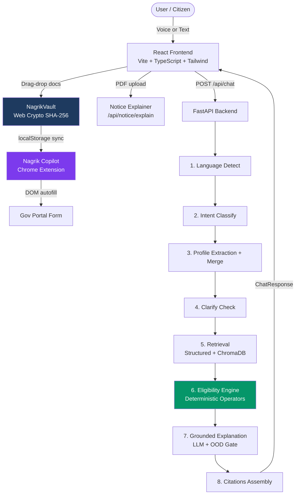

# NagrikAI — Multilingual Civic Intelligence Platform

> **IDEA//FORGE Online Hackathon** | Track 1: Civic Pulse — Digital Governance & Public Information  
> Problem Statement 1: *Multilingual Policy, Rights & Scheme Explainer*

NagrikAI makes Indian government schemes understandable, accessible, and actionable for every citizen — in **English**, **Hindi (हिंदी)**, and **Marathi (मराठी)**.

---

## ✨ What It Does

| Feature | Description |
|---|---|
| **Scheme Chat** | Conversational discovery of government schemes with multilingual voice input (Web Speech API) and text-to-speech output |
| **Eligibility Engine** | Deterministic rule-based eligibility evaluation — no LLM hallucination, every decision is code-verified |
| **Notice Explainer** | Upload any government circular/PDF — get a plain-language summary with page citations |
| **NagrikVault** | Client-side cryptographic document locker (SHA-256 fingerprinting, AES-256 UX branding) + 1-click profile auto-extraction |
| **Nagrik Copilot Extension** | Chrome extension that autofills government portal forms from your verified vault profile |

---

## 🏗️ Architecture



---

## 🚀 Quick Start

### Prerequisites
- Python 3.11+
- Node.js 18+
- (Optional) Groq API key or Gemini API key for LLM features — the app works fully without them via deterministic fallback

### 1. Clone & Environment

```bash
git clone https://github.com/your-username/nagrik-ai.git
cd "nagrik-ai"

# Copy env template
copy .env.example .env
# Edit .env and add your API keys (optional)
```

### 2. Backend Setup

```bash
# From the project ROOT directory (not from backend/)
cd backend
python -m venv venv

# Activate (Windows)
venv\Scripts\activate
# Activate (Linux/macOS)
# source venv/bin/activate

pip install -r requirements.txt
```

#### Build the ChromaDB Vector Index
```bash
# Run from the PROJECT ROOT
cd "c:\path\to\nagrik-ai"
backend\venv\Scripts\python.exe -m backend.app.ingest.build_index
```

#### Start the Backend Server
```bash
# ⚠️ IMPORTANT: Run uvicorn from the PROJECT ROOT, NOT from backend/
# Windows (from project root):
backend\venv\Scripts\uvicorn backend.app.main:app --reload --port 8000

# Linux/macOS (from project root):
# backend/venv/bin/uvicorn backend.app.main:app --reload --port 8000
```

- **Health check:** http://localhost:8000/api/health
- **API Docs (Swagger):** http://localhost:8000/docs

### 3. Frontend Setup

```bash
cd frontend
npm install
npm run dev
```

Frontend runs at: **http://localhost:5173**

---

## 🔑 Environment Variables

Create `.env` in the **project root** (copy from `.env.example`):

| Variable | Required | Description |
|---|---|---|
| `GROQ_API_KEY` | Optional | Groq LLM API key (free tier at console.groq.com) |
| `GEMINI_API_KEY` | Optional | Google Gemini API key (free at aistudio.google.com) |
| `DEFAULT_LLM_PROVIDER` | Optional | `groq` (default) or `gemini` |
| `GROQ_MODEL` | Optional | Default: `llama3-8b-8192` |
| `GEMINI_MODEL` | Optional | Default: `gemini-1.5-flash` |
| `APP_ENV` | Optional | `development` or `production` |
| `CORS_ORIGINS` | Optional | JSON array of allowed frontend origins |
| `EMBEDDING_MODEL` | Optional | Default: `intfloat/multilingual-e5-base` |
| `CHROMA_PERSIST_DIR` | Optional | Default: `backend/data/chroma` |

> **Note:** NagrikAI works fully without any API key using its built-in deterministic eligibility engine and grounded answer generator. LLM keys enhance explanations but are never required.

---

## 🎯 Demo Walkthrough (5-Step Judge Demo)

### Step 1 — Hindi Voice → Scheme Discovery
1. Open http://localhost:5173
2. Switch language to **हिंदी**
3. Click the 🎤 microphone icon and say: *"Main Pune ka kisan hoon, 1.2 hectare zameen hai"*
4. NagrikAI asks a clarifying question about income → answer: *"2 lakh rupaye"*
5. See PM-KISAN scheme card with eligibility checklist ✅/❌/❓

### Step 2 — Eligibility Check with Criteria Breakdown
1. Type: *"Am I eligible for PM Kisan?"*
2. See deterministic eligibility result with every criterion evaluated
3. Required documents and official portal link appear automatically

### Step 3 — Marathi Language Switch
1. Switch language to **मराठी**
2. Ask: *"पोस्ट मॅट्रिक शिष्यवृत्ती साठी मी पात्र आहे का?"*
3. See response entirely in Marathi with criteria checklist

### Step 4 — Notice Explainer
1. Click **Notice Explainer** tab
2. Upload any government circular PDF (or use a sample)
3. Get plain-language summary + key points + deadlines + page citations

### Step 5 — NagrikVault + 1-Click Autofill
1. Click **NagrikVault** tab
2. Upload a document (e.g. `Land_7_12_Extract_Pune.pdf`) → SHA-256 fingerprint generated
3. Click **"Sync with Browser Extension"** → profile synced to localStorage
4. Click **"Open Test Demo Portal"** → government portal form opens
5. Click **"⚡ Auto-Fill from NagrikVault"** → all 7 fields filled instantly with vault data

---

## 🧩 Chrome Extension — Nagrik Copilot

### Installation (Developer Mode)
1. Open Chrome → `chrome://extensions/`
2. Enable **Developer mode** (top right)
3. Click **"Load unpacked"**
4. Select the `extension/` folder from this repository
5. The Nagrik Copilot icon appears in your toolbar

### Usage
1. Complete the NagrikVault sync flow in the main app
2. Navigate to any government portal (or the demo portal)
3. Click the Nagrik Copilot extension icon
4. Click **"⚡ Autofill Form"** — fields are filled from your verified vault profile

---

## 🧪 Running Tests

```bash
# From project root
backend\venv\Scripts\python.exe -m pytest backend/tests/ -v
```

Expected: **17 passed** in ~20 seconds.

```
backend/tests/test_chat_smoke.py::test_farmer_journey_clarification_then_discovery PASSED
backend/tests/test_chat_smoke.py::test_student_scholarship_eligibility PASSED
backend/tests/test_chat_smoke.py::test_unspecified_source_question PASSED
backend/tests/test_chat_smoke.py::test_chat_api_endpoint PASSED
backend/tests/test_eligibility.py (5 tests) PASSED
backend/tests/test_profile.py (5 tests) PASSED
backend/tests/test_retrieval_smoke.py (3 tests) PASSED
```

### Frontend Type Check + Build
```bash
cd frontend
npm run build
```
Expected: 0 TypeScript errors, clean `dist/` output.

---

## 📂 Project Structure

```
nagrik-ai/
├── backend/
│   ├── app/
│   │   ├── api/           # FastAPI routes (chat, notice, schemes, eligibility)
│   │   ├── pipeline/      # 8-step civic intelligence pipeline
│   │   │   ├── intent.py      # Multilingual intent classifier
│   │   │   ├── profile.py     # Citizen profile extraction & merge
│   │   │   ├── retrieval.py   # ChromaDB + structured prefilter
│   │   │   ├── eligibility.py # Deterministic rule engine (11 operators)
│   │   │   ├── explain.py     # Grounded LLM + deterministic fallback
│   │   │   └── orchestrator.py
│   │   ├── llm/           # Groq (primary) + Gemini (fallback) clients
│   │   ├── ingest/        # ChromaDB index builder
│   │   ├── models.py      # Pydantic data models
│   │   └── data_loader.py
│   ├── data/
│   │   ├── schemes/       # pm-kisan.json, post-matric-scholarship.json
│   │   └── chroma/        # Vector DB (auto-generated)
│   ├── tests/             # 17 pytest tests
│   └── requirements.txt
├── frontend/
│   └── src/
│       ├── components/    # ChatWindow, NagrikVault, NoticeUpload, VoiceButton…
│       ├── lib/api.ts     # Backend API client
│       └── types.ts
├── extension/             # Chrome Extension (Manifest V3)
│   ├── manifest.json
│   ├── popup.html / popup.js
│   └── content.js         # Field matcher + autofill logic
├── .env.example
└── README.md
```

---

## 🔒 Privacy & Safety

- **No Aadhaar numbers** ever collected or stored
- **Session-only** citizen profiles — cleared on browser close / Reset Chat
- **NagrikVault** encryption keys remain strictly in browser memory — no document is sent to backend
- **Deterministic eligibility** — decisions are made by code, never by LLM
- **OOD grounding gate** — LLM is blocked from answering questions not grounded in source data
- All scheme data marked `verified: false` and `TODO_VERIFY` — demo data only, not guaranteed accurate

---

## ⚠️ Limitations

- **2 schemes** in the demo corpus (PM-KISAN, Post-Matric Scholarship) — easily extensible by adding JSON files to `backend/data/schemes/`
- **Voice input** requires a modern browser with Web Speech API (Chrome recommended)
- **NagrikVault** is a demo of the concept — real production would require a secure key management service
- **Scheme data** is unverified demo content — always check official portals for authoritative information
- **LLM responses** may vary; the deterministic fallback is always available

---

## 🛠️ Tech Stack

| Layer | Technology |
|---|---|
| Backend | Python 3.12, FastAPI, Uvicorn |
| Eligibility Engine | Custom deterministic rule engine (11 operators) |
| Vector Search | ChromaDB + `intfloat/multilingual-e5-base` embeddings |
| LLM | Groq (Llama/Qwen) primary, Google Gemini fallback |
| PDF Parsing | PyMuPDF (pymupdf ≥ 2.0) |
| Frontend | React 18, Vite, TypeScript, Tailwind CSS |
| Voice | Web Speech API (STT) + SpeechSynthesis (TTS) |
| Cryptography | Web Crypto API SHA-256 (real hash), AES-256 UX |
| Extension | Chrome Extension Manifest V3 |

---

## 📄 License

Built for IDEA//FORGE Hackathon 2026. All rights reserved.

> *"Making the machinery of the Indian state legible to every citizen."*
